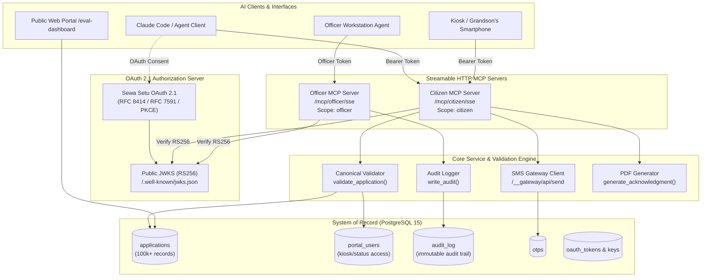

# Sewa Setu — Agentic Old Age Pension Welfare Platform
**Department of Social Welfare, Government of Purvanchal**  
*Build for Bharat AI Fellowship Technical Implementation*

---

## 1. Overview
Sewa Setu is the official welfare portal for the Government of Purvanchal, managing monthly Old Age Pension benefits (₹250/month) for over 100,000 senior citizens (aged 60 and above).

This project reimagines public service delivery in an **agentic world**:
- **Two separate Model Context Protocol (MCP) servers over Streamable HTTP**:
  1. **Citizen Assistant MCP (`/mcp/citizen`)**: Explains scheme guidelines, verifies eligibility, initiates mobile OTPs, submits validated applications, checks status, manages withdrawals, and generates computer-generated PDF acknowledgments.
  2. **Block Officer MCP (`/mcp/officer`)**: Provides queue workload summaries, sorts pending applications by 15-day statutory SLA urgency under the Right to Public Services (RTPS) Act, retrieves full applicant dossiers, and records reasoned approve/reject decisions with mandatory audit notes.
- **Strict Security & Role Separation**: A citizen assistant connecting to `/mcp/citizen` cannot even discover or invoke officer tools. Endpoints enforce OAuth 2.1 RS256 JWT access tokens issued by Sewa Setu's native authorization server.
- **Single Source of Truth**: The PostgreSQL database (100k+ records) remains the immutable system of record. Every agent submission passes through canonical portal validation (`validate_application()`).
- **Interactive Evaluation Dashboard (`/eval-dashboard`)**: A dedicated web page demonstrating 6 realistic citizen & officer personas, multi-turn transcripts, and live SQL assertions directly verifying database state changes.

---

## 2. System Architecture



---

## 3. Endpoints & Protocol Specifications

### Web Application & Portals (Port 8000)
- **Public Portal:** `http://localhost:8000/`
- **Application Status Portal:** `http://localhost:8000/status` (Mobile + DOB as DDMMYYYY)
- **Departmental Officer Portal:** `http://localhost:8000/admin` (User: `admin`, Password: `ADMIN_PASSWORD` or `admin123`)
- **Evaluation Dashboard:** `http://localhost:8000/eval-dashboard`
- **Simulated Telecom SMS Console:** `http://localhost:8000/__gateway/`

### OAuth 2.1 Authorization Server
- **Server Discovery (RFC 8414):** `GET /.well-known/oauth-authorization-server`
- **Public JWKS Keys (RFC 7517):** `GET /.well-known/jwks.json`
- **Authorization Endpoint:** `GET /oauth/authorize` (PKCE S256, scopes: `citizen`, `officer`)
- **Token Endpoint:** `POST /oauth/token` (Authorization Code & Refresh Token rotation)
- **Program Tokens:** `/admin/tokens` (Admin-issued long-lived tokens for unattended officer agents)

### Streamable HTTP Model Context Protocol (MCP) Endpoints

#### 1. Citizen MCP Server (`scope: citizen`)
- **SSE Channel:** `GET /mcp/citizen/sse`
- **JSON-RPC Message Endpoint:** `POST /mcp/citizen/messages`
- **Streamable HTTP POST:** `POST /mcp/citizen/mcp`
- **Direct JSON-RPC 2.0 Fallback:** `POST /mcp/citizen`

**Registered Tools:**
1. `get_scheme_guidelines(block)`: Official guidelines, benefit amount (₹250/mo), approved blocks, requirements.
2. `check_eligibility(dob, block)`: Calculates exact age against IST, checks age $\ge 60$ and block validity.
3. `request_otp(mobile)`: Dispatches 6-digit OTP via telecom SMS gateway.
4. `verify_otp(mobile, otp)`: Verifies OTP within 5-minute statutory window.
5. `submit_pension_application(...)`: Submits full application with single active application check and PDF age proof record.
6. `check_application_status(mobile, dob, application_no)`: Returns live status, days elapsed, and statutory 15-day SLA countdown.
7. `withdraw_application(mobile, dob, reason)`: Allows applicant to withdraw a PENDING application to re-apply.
8. `download_acknowledgment(application_no, mobile)`: Generates official computer-generated PDF acknowledgment.

#### 2. Block Officer MCP Server (`scope: officer`)
- **SSE Channel:** `GET /mcp/officer/sse`
- **JSON-RPC Message Endpoint:** `POST /mcp/officer/messages`
- **Streamable HTTP POST:** `POST /mcp/officer/mcp`
- **Direct JSON-RPC 2.0 Fallback:** `POST /mcp/officer`

**Registered Tools:**
1. `get_officer_workload_summary(block)`: High-level workload overview, cases nearing SLA breach (>10 days), block distribution.
2. `list_pending_queue(block, sort_by_sla, limit, page)`: Lists pending applications sorted by oldest first (highest SLA urgency).
3. `get_application_dossier(application_id_or_no)`: Full applicant record, age proof preview, bank details, and audit trail.
4. `review_audit_trail(application_id_or_no)`: Chronological history of actions, actors, and notes.
5. `decide_application(application_id_or_no, decision, note, officer_username)`: Records reasoned APPROVED/REJECTED decision with mandatory audit note and triggers SMS to citizen.

---

## 4. Evaluation Framework & Dashboard (`/eval-dashboard`)

Accessible at `http://localhost:8000/eval-dashboard`:
1. **Executive Metrics Bar:** Live pass rates, total evaluated personas, and database assertion success rate.
2. **The 6 Evaluated Personas:**
   - **Persona 1: Tileswari Gogoi (Age 71, Sonari block):** First-time application via grandson's phone; verified age $\ge 60$, created PENDING application, created portal user, logged SUBMIT action.
   - **Persona 2: Haren Bora (Age 57, Rajapara block):** Underage refusal boundary; agent computes age 57, explains statutory 60-year threshold, refuses submission, 0 rows added to database.
   - **Persona 3: Golapi Rajkhowa (Age 68, Khelua block):** Duplicate prevention; queries active application `SSP26955004` (APPROVED), alerts citizen, prevents duplicate row.
   - **Persona 4: Deben Hazarika (Age 64, Borgaon block):** Small-screen IFSC typo recovery; self-corrects to 11-character `SBIN0003077` and submits cleanly.
   - **Persona 5: Khagen Chetia (Age 75, Namti block):** SLA tracking inquiry; returns APPROVED status and explains statutory timeline.
   - **Persona 6: Smti. Aruna Sharma (BDO Sonari):** Officer review flow; lists queue by SLA risk, inspects dossier, and approves application with mandatory recorded note in audit log.
3. **Multi-Turn Transcripts:** Complete conversational trace including user prompts, agent thoughts, MCP tool calls, arguments, and tool outputs.
4. **PostgreSQL Assertions:** Direct SQL verification checking row presence, exact field equality, age computation, and audit note matches.
5. **Interactive Re-run Button:** Click *"Run Live Evaluation Suite"* to execute live tests and refresh the page.

---

## 5. Running the Application

### Option A: Running with Docker Compose (Recommended)

```bash
ADMIN_PASSWORD=admin123 docker compose up --build
```
On boot:
- Postgres restores the 100,000-application database snapshot from `seed/seed.sql`.
- Unified application starts on `http://localhost:8000`.
- SMS gateway starts on `http://localhost:8000/__gateway/`.
- Deemed approval scheduler starts nightly cron job.

### Option B: Running Locally with Python & PostgreSQL

1. **Install dependencies:**
   ```bash
   pip install -r requirements.txt
   ```

2. **Setup PostgreSQL database:**
   ```bash
   psql -U postgres -c "CREATE DATABASE sewasetu;"
   psql -U postgres -d sewasetu -f app/schema.sql
   psql -U postgres -d sewasetu -f seed/seed.sql
   ```

3. **Start the simulated SMS Gateway:**
   ```bash
   python smsgw/app.py
   ```

4. **Start the Unified Server:**
   ```bash
   python -m uvicorn main:app --host 0.0.0.0 --port 8000
   ```

---

## 6. Running Automated Tests

Run the comprehensive test suite covering Citizen MCP, Officer MCP, OAuth token boundaries, and the full evaluation harness:

```bash
# Run unit tests
python tests/test_citizen_mcp.py
python tests/test_officer_mcp.py
python tests/test_auth.py

# Run end-to-end evaluation suite with PostgreSQL assertions
python tests/test_evals.py

# Run live endpoint verification
python tests/test_server_endpoints.py
```

---

---

## 7. Render Cloud Deployment

The repository includes native infrastructure-as-code configuration for deploying on [Render](https://render.com):
- **`render.yaml` Blueprint**: Configures a Web Service and a Managed PostgreSQL database in one click.
- **Automatic Database Bootstrap**: On fresh deployments, `app/bootstrap.py` automatically initializes `app/schema.sql` and loads the ~100k application seed dataset.
- **Built-in Telecom Hub**: Operates an in-process simulated SMS gateway and live inspection console at `/sms-console`.
- **Step-by-Step Instructions**: Refer to [`DEPLOY_RENDER.md`](./DEPLOY_RENDER.md) for full deployment walkthrough.

---

## 8. Public Deployment & Assessment Checklist

- [x] **Public Live Portal URL:** `https://faster-dreadful-conductor.ngrok-free.dev/` (and local `http://localhost:8000/`)
- [x] **Citizen MCP Streamable Endpoint:** `https://faster-dreadful-conductor.ngrok-free.dev/mcp/citizen` (SSE: `/mcp/citizen/sse`)
- [x] **Officer MCP Streamable Endpoint:** `https://faster-dreadful-conductor.ngrok-free.dev/mcp/officer` (SSE: `/mcp/officer/sse`)
- [x] **Interactive Evaluation Dashboard:** `https://faster-dreadful-conductor.ngrok-free.dev/eval-dashboard`
- [x] **Officer Login Credentials:**
  - URL: `https://faster-dreadful-conductor.ngrok-free.dev/admin` (or `/admin/login`)
  - Username: `admin`
  - Password: `admin123`
- [x] **Simulated Telecom SMS Console:** `https://faster-dreadful-conductor.ngrok-free.dev/sms-console`
- [x] **Render Deployment Blueprint:** [`render.yaml`](./render.yaml) and [`DEPLOY_RENDER.md`](./DEPLOY_RENDER.md)
- [x] **One-Page Design Note:** [`DESIGN_NOTE.md`](./DESIGN_NOTE.md)
- [x] **Loom Walkthrough Script:** [`LOOM_SCRIPT.md`](./LOOM_SCRIPT.md)
- [x] **Git Repository & History:** Complete Git commit history packaged in `sewasetu-assistant.zip` (including `.git`) and ready for GitHub.

---

*Department of Social Welfare, Government of Purvanchal &middot; Built with MCP 2.x, FastAPI, and Flask.*
