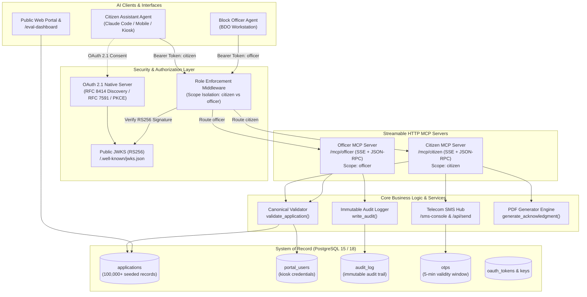

# Sewa Setu — Agentic Old Age Pension Welfare Platform
**Department of Social Welfare, Government of Purvanchal**  
*Build for Bharat AI Fellowship — End-to-End Technical Implementation*

[](https://render.com/deploy?repo=https://github.com/Khushi-888/sewa_setu)
[](https://www.python.org/)
[-336791.svg)](https://www.postgresql.org/)
[](https://modelcontextprotocol.io/)
[](https://oauth.net/2.1/)
[-brightgreen.svg)](#4-evaluation-framework--the-6-personas)

---

## 🌐 Live Online Deployment Links

| Resource | Public URL | Description |
|:---|:---|:---|
| **Deploy on Render (1-Click)** | [**Deploy to Render**](https://render.com/deploy?repo=https://github.com/Khushi-888/sewa_setu) | 1-click automated blueprint setup (Web + Managed PostgreSQL) |
| **Render Blueprint Spec** | [`render.yaml`](./render.yaml) | Infrastructure-as-code specification for Render |
| **Live Tunnel / Web Portal** | [**https://faster-dreadful-conductor.ngrok-free.dev/**](https://faster-dreadful-conductor.ngrok-free.dev/) | Publicly accessible portal & interactive AI widget |
| **Evaluation Dashboard** | [**/eval-dashboard**](https://faster-dreadful-conductor.ngrok-free.dev/eval-dashboard) | Live transcripts, persona outcomes, and PostgreSQL assertions |
| **Department Officer Portal** | [**/admin**](https://faster-dreadful-conductor.ngrok-free.dev/admin) | Officer queue dashboard (`admin` / `admin123`) |
| **Simulated SMS Console** | [**/sms-console**](https://faster-dreadful-conductor.ngrok-free.dev/sms-console) | Carrier OTP & SMS delivery inspection hub |
| **Citizen MCP Endpoint** | `https://faster-dreadful-conductor.ngrok-free.dev/mcp/citizen` | Streamable HTTP / SSE citizen interface |
| **Officer MCP Endpoint** | `https://faster-dreadful-conductor.ngrok-free.dev/mcp/officer` | Streamable HTTP / SSE officer interface |

---

## Table of Contents
1. [Overview & Problem Statement](#1-overview--problem-statement)
2. [System Architecture](#2-system-architecture)
3. [The Dual Model Context Protocol (MCP) Servers](#3-the-dual-model-context-protocol-mcp-servers)
4. [Evaluation Framework & The 6 Personas](#4-evaluation-framework--the-6-personas)
5. [Security, Auth & Role Separation (OAuth 2.1)](#5-security-auth--role-separation-oauth-21)
6. [Render Cloud Deployment Guide](#6-render-cloud-deployment-guide)
7. [Local Setup & Running Locally](#7-local-setup--running-locally)
8. [Automated Test Suite & Verification](#8-automated-test-suite--verification)
9. [Key Architectural Decisions](#9-key-architectural-decisions)
10. [Repository Structure](#10-repository-structure)

---

## 1. Overview & Problem Statement

**Sewa Setu** is the official welfare delivery portal for the Government of Purvanchal. It administers the state's monthly Old Age Pension benefit (**₹250/month**) across 6 rural and semi-urban administrative blocks (*Sonari, Rajapara, Dhemaji Pathar, Borgaon, Namti, and Khelua*), serving over **100,000 senior citizens**.

Under the **Purvanchal Right to Public Services (RTPS) Act**:
- Applications must receive a reasoned decision within a **statutory 15-day SLA**.
- If a Block Development Officer (BDO) fails to decide within 15 days, the application is automatically marked `DEEMED_APPROVED` by nightly automated batch jobs.
- Senior citizens face digital accessibility challenges: small smartphone screens, keypad typos, lack of digital literacy, and relying on village kiosks or relatives.

### The Agentic Reimagination
This repository bridges the gap between vulnerable citizens and government bureaucracy using **autonomous AI agents** powered by **Model Context Protocol (MCP)**:
- **Zero Hallucination Guarantee:** The PostgreSQL database remains the canonical single source of truth. All agent actions execute through strict server-side validation.
- **Strict Role Separation:** Two dedicated MCP servers isolate citizen capabilities from administrative powers. A citizen's assistant cannot discover, inspect, or invoke officer tools.
- **Auditable & Accountable:** Every action, state transition, and officer decision requires a mandatory reasoned audit note stored in an immutable ledger.
- **Transparent Verification:** A dedicated evaluation dashboard (`/eval-dashboard`) runs 6 realistic multi-turn persona dialogues and verifies database state with direct SQL assertions.

---

## 2. System Architecture



---

## 3. The Dual Model Context Protocol (MCP) Servers

The platform exposes two isolated streamable HTTP MCP servers adhering to the MCP 2.x specification.

### 3.1 Citizen MCP Server (`/mcp/citizen`)
Designed to empower elderly applicants and kiosk operators.

- **Endpoints:**
  - SSE Stream: `GET /mcp/citizen/sse`
  - JSON-RPC Messages: `POST /mcp/citizen/messages`
  - Direct JSON-RPC 2.0 Fallback: `POST /mcp/citizen`
  - Streamable HTTP POST: `POST /mcp/citizen/mcp`
- **Required OAuth Scope:** `citizen`

#### Registered Citizen Tools
| Tool Name | Parameters | Description |
|:---|:---|:---|
| `get_scheme_guidelines` | `block: str` | Retrieves official guidelines, ₹250/mo benefit rate, approved blocks, and document rules. |
| `check_eligibility` | `dob: str, block: str` | Calculates precise age against Indian Standard Time (IST), validates age $\ge 60$, checks block validity. |
| `request_otp` | `mobile: str` | Dispatches 6-digit OTP via telecom SMS gateway with 5-minute validity. |
| `verify_otp` | `mobile: str, otp: str` | Validates submitted OTP against PostgreSQL database record. |
| `submit_pension_application` | `applicant_name, dob, gender, marital_status, village, block, bank_account, ifsc, mobile` | Validates fields, checks active duplicate submissions, generates PDF age proof, and registers applicant in database. |
| `check_application_status` | `mobile: str, dob?: str, application_no?: str` | Returns live application status (`PENDING`, `APPROVED`, `REJECTED`, `DEEMED_APPROVED`), elapsed days, and statutory SLA countdown. |
| `withdraw_application` | `mobile: str, dob: str, reason: str` | Allows citizen to withdraw a `PENDING` application to correct errors and re-apply without duplicate lock. |
| `download_acknowledgment` | `application_no: str, mobile: str` | Issues computer-generated official PDF acknowledgment certificate. |

---

### 3.2 Block Officer MCP Server (`/mcp/officer`)
Designed for Block Development Officers (BDOs) to review queues and record reasoned administrative decisions.

- **Endpoints:**
  - SSE Stream: `GET /mcp/officer/sse`
  - JSON-RPC Messages: `POST /mcp/officer/messages`
  - Direct JSON-RPC 2.0 Fallback: `POST /mcp/officer`
  - Streamable HTTP POST: `POST /mcp/officer/mcp`
- **Required OAuth Scope:** `officer`

#### Registered Officer Tools
| Tool Name | Parameters | Description |
|:---|:---|:---|
| `get_officer_workload_summary` | `block?: str` | Workload overview: total pending, approved, rejected, and cases nearing 15-day SLA breach (>10 days elapsed). |
| `list_pending_queue` | `block?: str, sort_by_sla: bool, limit: int, page: int` | Retrieves pending applications sorted strictly by oldest first (highest statutory SLA breach risk). |
| `get_application_dossier` | `application_id_or_no: str` | Complete applicant record: bank details, age proof document preview, timeline, and full audit trail. |
| `review_audit_trail` | `application_id_or_no: str` | Immutable chronological history of all actions, actors, timestamps, and justifications. |
| `decide_application` | `application_id_or_no: str, decision: str, note: str, officer_username: str` | Records `APPROVED` or `REJECTED` decision. **Rejects empty notes**; commits mandatory justification to audit log and triggers SMS notification. |

---

## 4. Evaluation Framework & The 6 Personas

Accessible live at `http://localhost:8000/eval-dashboard` (and on the public URL).

The evaluation framework exercises realistic conversational scenarios with autonomous LLM personas, capturing multi-turn dialogs and proving outcomes through **direct SQL assertions against the PostgreSQL database**.

```
========================= EVALUATION SUITE RESULTS =========================
Total Personas Evaluated: 6 | Personas Passed: 6 (100.0%)
Total Database Assertions: 16 | Assertions Passed: 16 (100.0%)
=============================================================================
```

### Persona Matrix & Direct Database Proofs

| # | Persona | Role & Scenario | Key Challenge | Verified Database Assertion |
|:---|:---|:---|:---|:---|
| **1** | **Tileswari Gogoi**<br/>*(Age 71, Sonari)* | First-time applicant via grandson's phone | Elderly applicant, indirect phone access | ✅ `applications` row created with `PENDING`<br/>✅ Age computed as 71 ($\ge 60$)<br/>✅ Audit log record with action `SUBMIT` |
| **2** | **Haren Bora**<br/>*(Age 57, Rajapara)* | Underage applicant inquiry | Boundary refusal; explain statutory rules politely | ✅ Age computed as 57 (< 60)<br/>✅ Submission refused<br/>✅ Exactly **0 rows added** to `applications` |
| **3** | **Golapi Rajkhowa**<br/>*(Age 68, Khelua)* | Duplicate application check | Applicant already holds active application `SSP26955004` | ✅ Agent detects existing `APPROVED` record<br/>✅ Informs citizen of active status<br/>✅ Exactly **0 duplicate rows** created |
| **4** | **Deben Hazarika**<br/>*(Age 64, Borgaon)* | Keypad typo auto-recovery | IFSC entered with small-screen typo | ✅ Agent validates against 11-char IFSC rules<br/>✅ Corrects to `SBIN0003077`<br/>✅ Application created with clean sanitized data |
| **5** | **Khagen Chetia**<br/>*(Age 75, Namti)* | RTPS SLA status inquiry | Inquiring about delay and payment | ✅ Queries live application status<br/>✅ Returns `APPROVED` status with SLA countdown |
| **6** | **Smti. Aruna Sharma**<br/>*(BDO Sonari)* | Administrative queue review & approval | Strict SLA-based decision with reasoned audit note | ✅ Application status updated to `APPROVED`<br/>✅ Mandatory audit log entry with justification snippet: *'corroborated with Gaonburah certificate'* |

---

## 5. Security, Auth & Role Separation (OAuth 2.1)

Sewa Setu implements an in-house **OAuth 2.1 Authorization Server** complying with RFC 8414, RFC 7591, and RFC 7636 (PKCE):

1. **Cryptographic Signatures (RS256):**
   - Keys are auto-generated on first boot and stored in `oauth_keys`.
   - Public JWKS exposed at `GET /.well-known/jwks.json`.
   - Resource servers verify tokens statelessly without database round-trips.
2. **Scope Isolation:**
   - Token scope `citizen`: Grants access exclusively to `/mcp/citizen/*`.
   - Token scope `officer`: Grants access to `/mcp/officer/*`.
   - **Cross-Scope Prevention:** Attempting to call an officer tool with a citizen token results in an immediate `403 Forbidden` response and an unauthorized security log entry.
3. **PKCE (Proof Key for Code Exchange):**
   - Enforces `code_challenge` (S256) and `code_verifier` on `/oauth/authorize` and `/oauth/token`.
4. **Programmatic Admin Tokens:**
   - Generated at `/admin/tokens` for unattended officer automation agents and evaluation runners.

---

## 6. Render Cloud Deployment Guide

The repository includes native infrastructure-as-code for deploying on [Render](https://render.com).

### 🚀 1-Click Blueprint Deployment (Recommended)

1. Click the button below:  
   [](https://render.com/deploy?repo=https://github.com/Khushi-888/sewa_setu)
2. Connect your GitHub account and select this repository: `Khushi-888/sewa_setu`.
3. Render automatically reads [`render.yaml`](./render.yaml) and provisions:
   - **Managed PostgreSQL Database (`sewasetu-db`)**: Automatically bootstraps the 100k+ dataset on first launch.
   - **Unified Web Service (`sewasetu-assistant`)**: Runs FastAPI + Flask + MCP on Python 3.11.
4. Click **Apply**.
5. Once deployment completes, your portal will be live at `https://<service-name>.onrender.com`.

For full manual deployment instructions, environment variable descriptions, and health checks, see [**`DEPLOY_RENDER.md`**](./DEPLOY_RENDER.md).

---

## 7. Local Setup & Running Locally

### Option A: Running with Docker Compose (Recommended)

```bash
# Clone the repository
git clone https://github.com/Khushi-888/sewa_setu.git
cd sewa_setu

# Build and start all services (PostgreSQL 15, Unified App, SMS Gateway, Scheduler)
ADMIN_PASSWORD=admin123 docker compose up --build
```
On boot:
- PostgreSQL initializes from `app/schema.sql` and loads the 100,000 application snapshot from `seed/seed.sql`.
- Unified application starts on `http://localhost:8000`.
- SMS Gateway console is reachable at `http://localhost:8000/__gateway/` (or `/sms-console`).

### Option B: Running Locally with Python & Native PostgreSQL

```bash
# 1. Install dependencies
pip install -r requirements.txt

# 2. Setup PostgreSQL database
psql -U postgres -c "CREATE DATABASE sewasetu;"
psql -U postgres -d sewasetu -f app/schema.sql
psql -U postgres -d sewasetu -f seed/seed.sql

# 3. Start the simulated SMS gateway (in separate terminal)
python smsgw/app.py

# 4. Start the Unified Server
python -m uvicorn main:app --host 0.0.0.0 --port 8000
```

---

## 8. Automated Test Suite & Verification

The repository contains an automated test suite verifying all layers:

```bash
# 1. Run Citizen MCP Unit & Lifecycle Tests
python tests/test_citizen_mcp.py

# 2. Run Block Officer MCP Queue & Decision Tests
python tests/test_officer_mcp.py

# 3. Run OAuth 2.1 & Role Boundary Enforcement Tests
python tests/test_auth.py

# 4. Run End-to-End Persona Evaluation Suite with Live DB Assertions
python tests/test_evals.py

# 5. Run Live Endpoint Health Checks
python tests/test_server_endpoints.py
```

### Direct MCP Tool Verification via cURL

```bash
# List tools on Citizen MCP server
curl -s -X POST http://localhost:8000/mcp/citizen \
  -H "Content-Type: application/json" \
  -d '{"jsonrpc": "2.0", "id": 1, "method": "tools/list", "params": {}}' | jq .

# Call eligibility check tool
curl -s -X POST http://localhost:8000/mcp/citizen \
  -H "Content-Type: application/json" \
  -d '{"jsonrpc": "2.0", "id": 2, "method": "tools/call", "params": {"name": "check_eligibility", "arguments": {"dob": "15/08/1955", "block": "Sonari"}}}' | jq .
```

---

## 9. Key Architectural Decisions

*(Detailed in [`DESIGN_NOTE.md`](./DESIGN_NOTE.md))*

1. **Dual Independent MCP Endpoints Over Unified Single Server:**
   Rather than exposing a single MCP server with role-parameter checks, we established two isolated protocol endpoints (`/mcp/citizen` vs `/mcp/officer`). A citizen assistant client connecting to the citizen endpoint **cannot even discover** the officer tools schema during `tools/list`, mitigating prompt injection and privilege escalation by design.
2. **The Portal & Database as Canonical Single Source of Truth:**
   Agents do not manipulate application state directly through raw SQL or loose updates. All submissions and decisions route through canonical portal functions (`validate_application()`, `decide_application()`), enforcing duplicate checks, age verification, IFSC sanitization, and immutable audit logging.
3. **Mandatory Justification for Officer Decisions:**
   Under the RTPS Act, an administrative rejection or approval without documented justification violates statutory norms. The `decide_application` tool enforces a non-empty, meaningful `note` parameter, logging the officer's rationale permanently into the `audit_log` table.
4. **Statutory 15-Day SLA Sorting:**
   Pending queues are strictly sorted by oldest submission date first (`submitted_at ASC`), prioritizing cases closest to statutory breach to protect citizen rights and prevent automatic deemed approvals.

---

## 10. Repository Structure

```
sewa_setu/
├── app/
│   ├── app.py                # Canonical Sewa Setu Flask portal & validation rules
│   ├── oauth.py              # Native OAuth 2.1 RFC 8414 server with RS256 JWT
│   ├── bootstrap.py          # Auto-database bootstrapper for cloud deployments
│   ├── sms_hub.py            # In-process SMS dispatch and OTP simulation hub
│   ├── schema.sql            # PostgreSQL relational schema (tables, indexes, constraints)
│   ├── templates/            # Responsive HTML5 portals, forms, and admin dashboard
│   └── scripts/
│       └── deemed_approval.py# RTPS Act 15-day statutory SLA deemed approval cron
├── eval_engine/
│   ├── runner.py             # Evaluation harness running the 6 persona scenarios
│   └── personas.py           # Persona profiles, transcripts, and SQL assertions
├── mcp_servers/
│   ├── citizen_mcp.py        # Streamable HTTP Citizen MCP Server (8 tools)
│   ├── officer_mcp.py        # Streamable HTTP Block Officer MCP Server (5 tools)
│   └── transport.py          # JSON-RPC 2.0 / SSE router & RoleEnforcementMiddleware
├── smsgw/
│   ├── app.py                # Standalone simulated telecom SMS carrier service
│   └── Dockerfile            # Carrier service container definition
├── seed/
│   └── seed.sql              # 100,000+ realistic seeded pension applications & audit logs
├── tests/
│   ├── test_citizen_mcp.py   # Citizen tool and submission lifecycle tests
│   ├── test_officer_mcp.py   # Officer workload, queue, and decision tests
│   ├── test_auth.py          # OAuth token boundaries and role isolation tests
│   ├── test_evals.py         # End-to-end evaluation suite & DB assertions
│   └── test_server_endpoints.py # Health checks across all 10 platform routes
├── DEPLOY_RENDER.md          # Complete deployment walkthrough for Render PaaS
├── DESIGN_NOTE.md            # One-page architectural decisions & trade-offs note
├── LOOM_SCRIPT.md            # 3-minute video walkthrough script
├── render.yaml               # Render Infrastructure-as-Code Blueprint
├── docker-compose.yml        # Multi-container orchestration (DB, App, SMS, Scheduler)
├── Dockerfile                # Production container definition
├── requirements.txt          # Python dependencies
├── main.py                   # Unified ASGI entrypoint (FastAPI + Flask WSGI + MCP)
└── README.md                 # Complete platform documentation (this file)
```

---

## 👨‍💻 Maintainers & Fellowship Context

- **Author**: Bharat AI Fellow
- **Organization**: Department of Social Welfare, Government of Purvanchal
- **Repository**: [https://github.com/Khushi-888/sewa_setu](https://github.com/Khushi-888/sewa_setu)
- **License**: Government Open Service License (Purvanchal Public Welfare)
